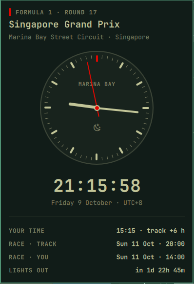

# Paddock Clock

An Omarchy bar plugin that tells you what time it is at the Formula 1 track.

A checkered flag sits in the bar. Click it for a clock showing the local time
at the circuit hosting the current or next Grand Prix, along with the race start
in track time and your time, and a countdown to lights out.



## Installation

Install and enable the plugin with Omarchy:

```bash
omarchy plugin add https://github.com/yubinex/omarchy-paddock-clock.git --enable
```

Update it later with:

```bash
omarchy plugin update yubinex.paddock-clock --yes
```

## Controls

- Left click: open or close the clock panel
- Right click: open the season calendar on formula1.com
- Middle click: refresh the race calendar
- Hover: quick tooltip with the circuit and its local time

## Data sources

- Calendar: [Jolpica F1 API](https://api.jolpi.ca/), refreshed hourly.
- Timezones: a built-in circuit-to-timezone map, falling back to
  [Open-Meteo](https://open-meteo.com/) for circuits not in the map.
- Local time is computed with the system `date` and tzdata, so daylight saving
  time is handled correctly.

## Trademarks

This is an unofficial project and is not associated with Formula 1 companies.
F1, FORMULA ONE, FORMULA 1 and GRAND PRIX are trademarks of Formula One
Licensing B.V.

## License

[MIT](LICENSE)
